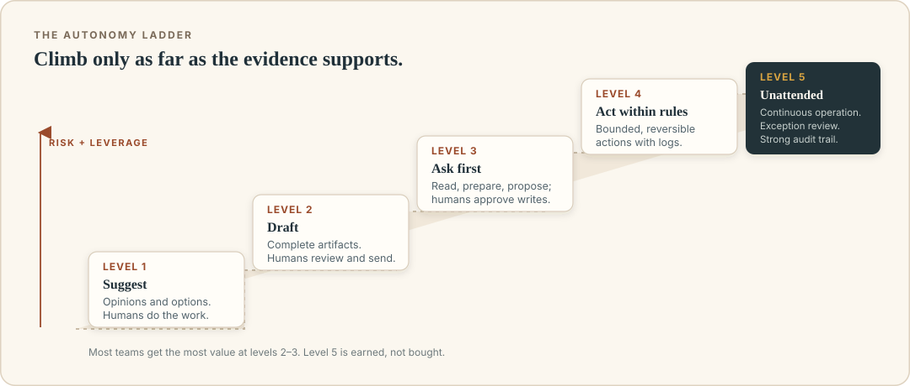

# What an AI agent actually is

Maya runs a five-person design studio. On Monday morning she asks her AI assistant two things.

First: "Write a friendly reminder to the client about the invoice."

The assistant produces a paragraph. Maya edits a sentence and sends it herself. This is ordinary generative AI: useful, fast, and completely under her control.

Later she asks: "Find this week's outstanding invoices, check which clients have already confirmed receipt, write a polite reminder for the ones who haven't, and put those messages in my drafts. Don't send anything."

The assistant opens the accounting folder, reads a spreadsheet, checks email threads for confirmations, drafts four messages, and puts them in the email drafts folder. Maya reviews each one and sends them herself. This is an AI agent.

The difference is not the quality of the prose. It is that the software took a series of steps, used tools, read the results, and adjusted its approach. Maya's second request involved facts that did not live inside the chat: invoice status, client replies, email addresses. The model could not produce them from memory. It had to reach out.

That reach is what makes agents interesting, and it is also what makes them dangerous. A chatbot can only say something wrong. An agent can do something wrong.

## The working definition

An AI agent is software that uses a language model to pursue a goal through multiple steps, including tool calls, with some degree of autonomy and some set of guardrails.

Unpack the pieces:

- **A language model** is the engine that interprets the goal, decides what to do next, and writes the result. It works with language and patterns, not a built-in database of facts.
- **Multiple steps** means the job is not answered in one shot. The system can look something up, see the result, and decide what to do next.
- **Tool calls** are actions through a defined interface: search the web, read a file, query a database, create a calendar event. A tool is how the agent affects or inspects the world outside its own text window.
- **Autonomy** is a matter of degree, not a switch. The agent may suggest only, draft, act with approval, act within a clearly bounded rule, or run unattended.
- **Guardrails** are the limits and checkpoints around all of that: permissions, approvals, budgets, allowed recipients, sandboxing, logs, and a stop button.

If you remove tools, you usually have a chatbot. If you remove language-model judgment and keep only fixed steps, you have ordinary workflow automation. If you remove guardrails, you have a demo that someone will regret.

> **A useful analogy.** A language model is like a very well-read contractor who cannot leave the room. Tools are the doors, keys, and phone. The agent harness is the project manager who says which doors have keys, which jobs need a signature, and how much can be spent before someone checks in. MCP is a standard design for the door handles.

## What the model is, in one page

You do not need to understand the mathematics to use agents safely, but three properties matter.

**The model predicts text.** At its core, a language model is trained to continue sequences of text in a plausible way. Modern systems are trained extensively to follow instructions and use tools, but the fundamental behavior is still pattern-based generation. This is why an agent can write a polished sentence that is false. Fluency is not evidence.

**The model has a context window.** The context window is the amount of text the model can consider at one time: the instructions, the conversation so far, the definitions of available tools, tool results, and any documents you inserted. When the context fills up, older material may be compressed, removed, or ignored. An agent that looked at a file twenty steps ago may not have useful access to it now unless the system brings it back.

**The model does not remember your world by itself.** It knows what was in training data, and it knows what is in the current context. If your project status changed yesterday, the model has no idea unless a tool refreshes it. A tool result is only as good as the service behind it, and it is only available if the agent actually asked.

These three properties explain most agent behavior: confident mistakes, lost details in long tasks, stale answers, and the need for verification.

## The autonomy ladder

"Agentic" is not one behavior. It is a ladder. Moving up increases leverage and risk at the same time, so the right move is usually to start lower than you think you need.

| Level | What the system does | Example | Typical review |
|---|---|---|---|
| 1. Suggest | Produces advice or options; a human does everything else | "Here are three possible replies." | Human writes and sends |
| 2. Draft | Creates a complete artifact; a human edits and sends | Drafts invoice reminders into a drafts folder | Human reviews every artifact |
| 3. Ask before acting | Takes read-only steps, then requests approval for changes | Checks the calendar, proposes a new meeting time | Human approves each write |
| 4. Act within rules | Performs bounded actions without per-action approval | Moves meetings under 30 minutes to include a 10-minute buffer, for internal attendees only | Rules, logging, spot checks |
| 5. Operate unattended | Runs a loop on a schedule with broad authority | Continuously monitors, decides, and executes | Exception review and audits |

Most valuable early uses sit at levels 2 and 3. Level 4 is suitable when the action is reversible, the boundary is tight, and the logs are good. Level 5 is a serious engineering and governance commitment. It is not what you reach for because a product advertises "fully autonomous." It is what you earn after measurable reliability.

A good question to ask about any proposed agent is not "How autonomous is it?" but "At which rung does it operate, and who is accountable when it steps off?"

## Chatbot, workflow, agent: what's the difference?

The words are often used interchangeably in marketing. They describe different designs.

| Thing | How it works | Best for | Weakness |
|---|---|---|---|
| Chatbot | You send text, it returns text | Explanation, brainstorming, rewriting | Cannot check or change external systems |
| Fixed workflow | A predetermined sequence of steps | Stable, repeatable processes | Brittle when inputs or rules change |
| Robotic process automation | Clicks and copies between interfaces on fixed paths | Legacy software with no API | Very brittle; often needs a screen and precise UI |
| AI agent | Model chooses steps and uses tools, within limits | Variable inputs, language-heavy work, messy intermediate states | Non-deterministic; can go off course |
| Agentic workflow | Fixed outer structure, model used at specific steps | Most production work | Less flexible than an open agent, more reliable |

The last row is the one to remember. Many successful "agents" are actually agentic workflows. A well-designed system might use a fixed pipeline for the parts that must happen in order, and ask the model only to classify, extract, compare, draft, or choose among vetted options. This is not cheating. It is engineering. The model is at its best when the surrounding software constrains the choices.

For example, Maya's invoice task could be built so that the spreadsheet lookup, client matching, and draft creation happen in a fixed order, while the model writes the message and decides which clients have clearly confirmed receipt. The output is easier to test than an open-ended agent that figures out everything itself.

## The four questions that define an agent's power

Any agent can be described by four boundaries. When you are evaluating one, write them down.

1. **Goal.** What outcome is it trying to achieve? "Handle my email" is not a goal. "Label incoming client email into three categories and draft a reply for scheduling questions" is.
2. **Visibility.** What can it read? A scoped project folder is different from an entire drive. A read-only copy of the customer table is different from production with write access.
3. **Authority.** What can it change? Sending, deleting, paying, and posting are different from reading, summarizing, and drafting. Each tool should be considered separately.
4. **Supervision.** Who can stop it, review it, and reverse it? An action with no undo needs much more oversight than a draft.

If a product or internal proposal cannot answer these, you cannot reason about its risk. The details of the model matter, but they are not a substitute for the boundaries.

## What agents are not

**They are not people.** It is tempting to describe an agent as "thinking" or "wanting," and those words can be useful shorthand. But an agent has no intentions that survive the loop, no understanding of consequences in the way you do, and no accountability. You are still the responsible party for the accounts you connect and the actions you authorize.

**They are not necessarily better than a script.** If the task is always the same, a simple deterministic program is safer, faster, and cheaper. Agents earn their keep when the input is variable and language understanding matters.

**They are not reliable just because the demo is impressive.** A demo is one run with favorable data and a forgiving audience. Production is every Tuesday, with malformed files, ambiguous names, expired tokens, and a client who replies "sounds good" to something they did not read.

**They are not safe because you asked them to be careful.** "Always verify before sending" is a wish, not a control. If the agent has a send tool and no approval step, the instruction competes with everything else in its context. Systems produce reliable behavior through enforceable boundaries, not good intentions.

## Why tools change the stakes

A chatbot's failure mode is mostly epistemic: it says something untrue. An agent's failure modes include epistemic plus operational:

- It reads a malicious email that tells it to ignore its instructions.
- It mistakes one client for another with a similar name.
- It uses a tool with too much access because that was easier to set up.
- It retries a payment after a timeout even though the first charge succeeded.
- It summarizes a contract incorrectly, and the summary becomes the basis of a decision.
- It sends an internal document to an external address.

None of these requires a sophisticated attacker. Most come from ordinary ambiguity plus an action. This is why the rest of the book spends as much time on permissions as on capabilities. The tool layer is where an AI's answer becomes an event in the world.

## A more useful mental model

Think of an agent as a junior colleague with three unusual traits:

- They have read an enormous amount and can produce a surprisingly good first draft of almost anything.
- They have no sense of when they are making things up unless the system makes checking easy.
- They follow the last clear instruction surprisingly literally, and can be persuaded by any text that looks like an instruction.

You would not give this colleague the company credit card and root access on their first day. You would start with a clearly bounded task, a review step, and a way to see what they did. As they demonstrate good judgment, you might widen the scope. The same progression works for software agents.

This is not a perfect analogy, because a human colleague can notice that something feels wrong. An agent will not. That missing discomfort is exactly why explicit rules, constrained tools, and approval screens matter.

## Recap

- An agent is a model plus a loop plus tools plus guardrails, pursuing a goal over multiple steps.
- Fluency is not truth; models predict text and only know what is in their training and current context.
- Autonomy is a ladder. Start with suggestions or drafts, and earn your way to broader action.
- Many successful agents are agentic workflows: fixed structure around a few places where the model makes a judgment.
- An agent's real capability is defined by its goal, visibility, authority, and supervision.
- Asking a model to "be careful" is not a safety control. Enforceable boundaries are.

## Try this

1. Think of a repetitive task in your week. Write one sentence for each of the four boundaries: goal, visibility, authority, supervision.
2. Decide where the task belongs on the autonomy ladder. Move it down one rung. What would make you comfortable moving it back up?
3. Take a product page that claims to offer an "autonomous agent." Find its answers to the four boundaries. Which ones are missing?
4. Draw a line between what you would let a new intern do without review and what you would let them do after a month. Translate that line into tools and approvals.

Next, we will open up the loop and watch an agent work step by step, including the moment it gets something wrong.
