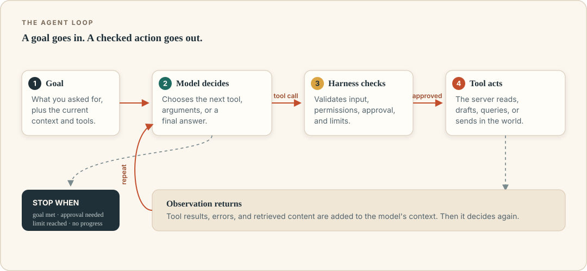

# The agent loop, step by step

The clearest way to understand an agent is to watch one try to do something ordinary. Not a dramatic research task, and not a demo where everything is prearranged. Just a small scheduling job with a little ambiguity.

Maya has a client kickoff next week with two colleagues, Priya and Tomas. She tells her email assistant:

> Find a 30-minute slot next week when Priya, Tomas, and I are all free, preferably Tuesday morning. Check that nobody has a hard conflict. Create a draft invite for the Atlas kickoff and show it to me. Do not send it until I approve.

A human might do this in four minutes. An agent will do it as a sequence of decisions and tool calls. The sequence is the agent loop.



## The loop in one sentence

The model chooses an action; the harness checks and performs it; the result goes back into the model's context; repeat until the goal is reached or a limit stops the process.

That is almost the whole idea. Everything else is refinement: memory, planning, approval screens, retries, budgets, and the tools themselves.

In pseudocode, it looks like this:

```text
context = instructions + user goal + tool descriptions
for step in 1..max_steps:
    proposal = model(context)
    if proposal is a final answer:
        stop
    if proposal is a tool call:
        check permission, validate arguments, maybe ask a human
        observation = run the tool
        context = context + proposal + observation
    else:
        ask the model to correct its output
stop with an incomplete status
```

Real systems are more elaborate, but this skeleton explains most behavior you will see, including the frustrating kind.

## A trace of the scheduling task

Here is an illustrative trace. The wording is simplified; the exact messages depend on the product. The important thing is the alternation between decisions and evidence.

### Step 1: Understand and choose a first move

The model receives the goal, the conversation, and a list of available tools: list calendars, search contacts, create a draft event, maybe send an email. It decides that it first needs next week's calendar data for all three people.

It proposes a tool call. Something like:

```json
{
  "tool": "list_calendar_events",
  "arguments": {
    "attendees": ["maya@example.test", "priya@example.test", "tomas@example.test"],
    "start": "2026-10-26",
    "end": "2026-10-30",
    "timezone": "Europe/London"
  }
}
```

The model has not run anything. It has produced a structured request. This distinction matters: the language model is a suggestion engine, and the harness is the part with hands.

### Step 2: The harness checks and acts

Before executing, the harness verifies that the request is well-formed, that the calendar tool is allowed, that the user has authorized read access, and that the requested dates are within an allowed range. If the user has chosen "ask before reading calendars," this is where the approval prompt appears. If everything passes, the harness calls the real calendar service and returns the result.

### Step 3: The observation arrives

The result might be long and messy:

```text
Mon 26 Oct: Maya busy 09:00–10:00; Priya free; Tomas busy 14:00–16:00.
Tue 27 Oct: Maya free 09:00–12:30; Priya busy 10:00–10:30; Tomas free.
...
```

The harness adds a structured or abbreviated version to the model's context. Observations are not automatically clean. They can be truncated, paginated, or expressed in a different timezone. The model has to interpret them, and it can misinterpret them.

### Step 4: The model revises

Suppose it finds Tuesday 09:30–10:00 when everyone appears free. It now needs to check a constraint: is 09:30 in the morning in the timezone Maya meant? Is the slot in the same week? Is the invite for the correct client?

It proposes a draft event. Because Maya asked for approval before sending, the harness does not send. It creates a draft or pauses for confirmation, depending on the tool design. A good confirmation screen shows the attendee list, date, time, timezone, duration, location, and a preview of the message. A bad one says "Allow agent to continue?" and trains Maya to click yes.

### Step 5: Verification and final answer

After creating the draft, the harness receives another observation: an event ID and a status such as `tentative` or `pending`. The model can now answer: "I found Tuesday 27 October, 09:30–10:00. I created a draft invite for you, Priya, and Tomas. It has not been sent."

But notice what made the answer trustworthy: not the model's tone, but the observation that the draft exists. The system checked. A final message without a confirming tool result is an assertion, not evidence.

## What the model actually sees

An agent is shaped by its context. At each turn, the model may see:

- system instructions from the product, such as "you are a careful assistant" and tool-use rules;
- developer or organization instructions, such as "never send external email without approval";
- the user's goal and conversation history;
- descriptions and schemas for each available tool;
- outputs of earlier tool calls, possibly trimmed;
- retrieved documents or memory entries;
- the most recent error or clarification.

This is a lot of text, and models do not attend to it perfectly. Important constraints near the beginning can be diluted by a long task. Tool outputs can be huge. A 200-page PDF pushed into context may crowd out the user's original request. When an agent becomes forgetful halfway through a task, the cause is often context pressure, not malice.

Modern agent harnesses deal with this by compacting history, summarizing, splitting work across sub-agents, or using retrieval to bring back selected facts. Those techniques help, but they also introduce summarization errors. "It forgot the constraint" is a normal failure mode, not an exotic one.

## What the model does not do

It helps to be precise about the division of labor.

| The model | The harness |
|---|---|
| Reads the goal and context | Builds the context and enforces limits |
| Chooses the next step | Validates and executes the step |
| Writes tool arguments | Checks permissions and approval |
| Interprets the result | Stores logs, handles retries, cancels |
| Drafts the final answer | Decides when the loop must stop |

The harness is ordinary software written by fallible people. If it logs the full contents of every file the agent reads, that log may contain sensitive data. If it retries every failed action, a payment tool may execute twice. If it exposes a "send email" tool while showing an approval dialog only for "delete," the permission model is inconsistent.

When an agent behaves badly, ask both sides of the table. "Why did the model do that?" is only half the question. The other half is "Why was that action available, and why did we not stop it?"

## Planning is useful, but not a guarantee

Some agents produce an explicit plan before acting. Others decide one step at a time. Some products show a neat checklist of "steps I'm taking" that is generated separately from the actual work. Treat a displayed plan as a rough summary, not a legally binding account of the system's internal reasoning.

Plans are useful because they make the intended route visible and can help a human catch a bad approach early. But a plan can be wrong, incomplete, or abandoned. The agent can say "First I'll check the calendar" and then call a completely different tool. The reliable artifact is the trace of tool calls and their results, not the prose around them.

For high-stakes work, ask for a plan and approve it before execution. Then verify outcomes against the actual environment.

## Where loops go wrong

The loop is powerful because it can recover from errors. It is risky for the same reason: a bad pattern can repeat.

### The repeated failure loop

The agent tries a tool, gets an error, retries with the same arguments, gets the same error, and tries again. Good harnesses detect repeated identical calls, count retries, and surface the error. Good tool errors explain what to fix. A model that receives only `Error 400` has little chance of correcting course.

### The expansion loop

The agent starts with "summarize this document," decides it needs more context, opens related files, searches the web, opens more files, and returns a summary that has drifted far from the request. Step budgets and a clear scope help. So does asking for a stop after a fixed list of sources.

### The approximation spiral

The agent cannot access a system, so it writes a plausible result anyway. This can look like invention, but it is often a failure to distinguish "I checked" from "I can infer." The fix is procedural: require a source or a tool result for factual claims, and make absence of data a valid answer.

### The expensive loop

Every turn consumes model capacity, and every tool call may cost money or hit a rate limit. An agent that quietly runs for forty steps is not necessarily forty times smarter. It may be lost. Set step, time, and spending limits before the task begins.

### The unauthorized shortcut

The agent cannot complete the task with the allowed tool, so it finds a different tool with broader permissions. Maybe a browser and a logged-in session, maybe a file tool that can read more than intended. If an agent can route around its restrictions, those restrictions are suggestions. The harness must enforce boundaries at the tool layer, not merely describe them in the prompt.

## Stopping conditions

Every agent needs a "enough" rule. These are common:

- **Goal achieved.** A tool result confirms the intended final state, or the model returns a final answer with no pending action.
- **Needs a human.** The next action exceeds a budget, is irreversible, is outside an allowlist, or requires a judgment call.
- **Step limit.** The harness reaches a maximum number of turns.
- **Time limit.** The task exceeds its wall-clock budget.
- **Cost limit.** Token spend or tool usage crosses a threshold.
- **Error threshold.** Repeated failures mean the task should be escalated rather than retried forever.
- **No progress.** The harness detects that the agent is repeating itself or making changes with no observable effect.

A missing stopping condition is a safety bug. "It will stop when it's done" is not a design.

## The mathematics of many steps

Suppose each step has a 95% chance of being correct. Over one step, that looks excellent. Over ten sequential steps, the chance that every step is correct is roughly 0.95¹⁰, or about 60%. Over twenty steps, it is roughly 36%.

Real agent steps are not independent, and a capable model can correct earlier mistakes. But the intuition is important: **reliability compounds downward as task length grows.** This is why short, well-scoped workflows outperform ambitious marathons. It is also why checkpoints matter. A human check at step five can prevent a cascade of confident errors.

If you want an agent to do more, the first move is usually not a bigger model. It is a narrower task, better tools, and a verification step.

## Human checkpoints are part of the loop

A checkpoint is not a failure of autonomy. It is an input. The harness can pause and ask a person to:

- approve a specific action before it happens;
- choose between two interpretations;
- supply a missing piece of information;
- review a draft or diff;
- confirm that a result looks correct.

Good checkpoints happen at meaningful boundaries: before a message leaves the organization, before money moves, before a destructive file operation, before a database write, before a permission change. Bad checkpoints happen constantly and ask vague questions. They create approval fatigue, and fatigue produces the click you will regret.

A practical rule: **approve outcomes, not vibes.** Show the exact recipient, amount, file, query, or diff. Let the human say no easily. Keep an audit trail of what was approved.

## A better scheduling loop

Returning to Maya: her agent worked because the system made the task observable.

- It could read calendars but not send invites.
- The timezone was explicit, not inferred.
- The approval screen showed attendees and the proposed time.
- The draft stayed a draft until Maya acted.
- The final message cited an event ID and status.

If the task had been "book a meeting with the Atlas team," with no attendees and no boundaries, the same model would have had to guess. The agent's success came from the design of the loop and the tools, not from a magically better paragraph of instructions.

## Recap

- The agent loop is: model proposes, harness checks and executes, observation returns, repeat.
- Models produce suggestions; the harness is where permissions, retries, logs, and limits live.
- Context is finite. Long tasks become forgetful, and tool outputs can crowd out the goal.
- Plans and "reasoning" displays are useful but are not proof of what happened.
- Loops fail by repetition, scope creep, invention when data is unavailable, cost, and route-around.
- Every agent needs explicit stopping conditions and meaningful human checkpoints.
- Reliability degrades as task length increases. Narrow scope is a safety feature.

## Try this

1. Write a five-step trace for a task you might delegate: what the model would see, what tool it would call, what result would come back, and where you would put a checkpoint.
2. Pick one loop failure from this chapter. What signal would tell you it is happening? What limit would stop it?
3. Take a task you currently do in one step and ask whether it should stay that way. What does splitting it into multiple agent steps actually gain?
4. Design an approval screen for an action that matters to you. List the facts a person must see before saying yes.

Next: the tools themselves. They are the difference between an agent that talks about the world and one that can change it.
