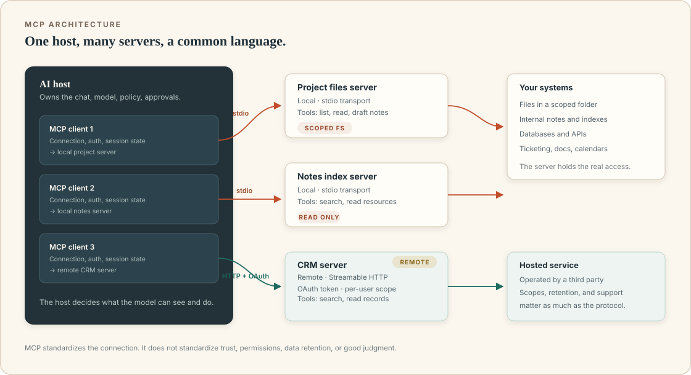

# MCP: one plug for many tools

For years, connecting an AI assistant to your files meant a custom integration: one plugin for one product, with its own authentication, its own permission model, and its own quirks. Add a second AI app and you built the integration again. Add a second data source and you built another. A team could spend more time wiring tools than using them.

Then came a deceptively simple idea: what if AI applications and tool providers agreed on a standard way to describe and call capabilities? The AI app would not need to know how your project tracker works internally. It would just need to speak the same protocol as the server that exposes the tracker. Swap the AI app, and the server still works. Add a new tool, and every compatible app can discover it.

That standard is the **Model Context Protocol**, usually called **MCP**. The shorthand comparison is USB-C: a common connector for many devices. The comparison is useful, as long as you remember that a universal port does not guarantee that the device on the other end is safe. A USB-C port can charge your phone or fry it if the charger is malicious. Standards make connections easier; they do not remove the need to choose what you connect.

## The problem MCP solves

Imagine four AI applications and six systems people want to connect: a shared drive, email, a calendar, a project tracker, a customer database, and a support inbox.

Without a standard, each app might build its own connector for each system. That is up to 24 integrations. Each one has to handle authentication, data formatting, error handling, updates, and a different product's notion of a "tool." When the drive API changes, many integrations break.

With a standard, each AI app implements one MCP client, and each system provides one MCP server. The matrix becomes much smaller: applications and tool servers meet at a common interface. The server author describes tools once. The app discovers them at runtime. The integration surface is shared instead of repeatedly reinvented.

This is the core benefit: **portability of capability**. Not magic. Not model intelligence. Less bespoke wiring.

## The three roles

MCP uses a host-client-server architecture. The names are easy to mix up, so it is worth fixing them early.



### The host

The **host** is the AI application you actually use. It might be a desktop assistant, an IDE, a chat product, or an internal tool. The host owns the conversation, calls the language model, presents approval screens, and decides which servers and tools the user may access.

The host is also where policy belongs. It decides whether a tool is enabled for this conversation, whether an action needs confirmation, and which files or roots the agent may see. A server can request things; the host should not blindly obey.

### The client

An **MCP client** is the connection manager inside the host. It speaks MCP to one server and keeps track of that server's capabilities. A host with three connected servers might maintain three client connections. The typical design is one client per server connection, inside a single host application.

You will rarely interact with a client as a normal user. It is plumbing. But it is where important boundaries live: transport, authentication, session state, and the messages exchanged.

### The server

An **MCP server** is the program that exposes capabilities. It might expose a folder of documents, a database, a ticketing system, a code repository, or a set of internal APIs. It translates MCP requests into real operations and returns results.

"Server" does not always mean a machine in a data center. A local server is often a small program started by the host on your own computer, communicating over standard input and output. A remote server is reached over the network. Both can be MCP servers. This distinction matters enormously for security: a local server runs as code on your machine, while a remote server receives data across a network boundary.

## What a server can expose

MCP has three main server-side primitives. They are often described with a simple division of control:

| Primitive | Who decides to use it | What it is | Example |
|---|---|---|---|
| **Tools** | The model, within host policy | Actions or computations with structured inputs | Search orders, create a draft, run a query |
| **Resources** | The host or application | Readable data identified by a URI | A document, a log file, a customer record |
| **Prompts** | The user | Reusable prompt templates | "Summarize this week's support themes" |

### Tools

Tools are the best-known part of MCP. They are the model-facing actions: functions with names, descriptions, input schemas, and results. A tool can be read-only or can change something in the outside world. The protocol can carry hints about whether a tool is read-only or destructive, but those are annotations, not enforcement. The server and host must enforce real permissions.

### Resources

Resources are data the application can read, addressed by a URI. A server might expose a document as `notes://project-atlas/brief`, or a record as `customers://acme`, or a file under a known path. Resources are often used to provide context: the user selects a document, or the host attaches it to the conversation.

Resources are more application-controlled than tools. A chat product might show them in an attachment picker or a resource browser. This is a useful distinction: not every piece of data should be a tool the model can call freely. Sometimes you want the human to choose the material.

### Prompts

Prompts are reusable templates that a user can invoke, often exposed as slash commands or menu items. A server might provide a prompt called `review_contract` with an argument for the contract resource. The prompt contains expert instructions and can structure the request for the model.

Prompts are not the same as the system prompt of the agent. They are templates offered by a server. They can be useful for standard workflows and can encode organizational knowledge: how to review a proposal, how to triage a ticket, what questions to ask before scheduling. Because prompts are user-controlled, they are a way to add guidance without giving the model another action.

### Client-side features

The protocol also defines ways for servers to interact with the client or user:

- **Sampling** lets a server request a language-model completion through the client, rather than requiring its own model API key. The client remains in control of whether to sample and what model to use.
- **Roots** let a client tell a server which filesystem locations are in scope for a session. They are a boundary signal, not an airtight sandbox.
- **Elicitation** lets a server request additional input from the user through the client.

Support varies by host and server. A feature existing in the specification does not mean your particular app implements it. Treat capability support as something to verify, not assume.

## The protocol underneath

MCP uses **JSON-RPC 2.0** for messages. JSON-RPC is a simple way to encode requests, responses, notifications, and errors as JSON. A request has a method name, a request ID, and parameters. A response echoes the ID and includes either a result or an error.

That sounds technical, but the shape is intuitive. A client might send:

```json
{
  "jsonrpc": "2.0",
  "id": 1,
  "method": "tools/list",
  "params": {}
}
```

A server responds with a list of tools. To use one, the client sends `tools/call` with a name and arguments:

```json
{
  "jsonrpc": "2.0",
  "id": 2,
  "method": "tools/call",
  "params": {
    "name": "count_words",
    "arguments": {
      "text": "A short example for the manual."
    }
  }
}
```

The server returns content and possibly structured data. Errors use JSON-RPC's error object, with codes for standard conditions and room for server-defined details.

### The startup handshake

Before tools can be used, the client and server perform an initialization handshake. They exchange:

- protocol version;
- each side's capabilities;
- client and server identifying information;
- any instructions or metadata the server wants to share.

A request might look like this:

```json
{
  "jsonrpc": "2.0",
  "id": 1,
  "method": "initialize",
  "params": {
    "protocolVersion": "2025-06-18",
    "capabilities": {},
    "clientInfo": { "name": "example-host", "version": "1.0.0" }
  }
}
```

The server replies with its supported capabilities: perhaps `tools`, `resources`, and `prompts`, plus details such as whether resource subscriptions are supported. Then the client sends an `initialized` notification, and discovery can begin: list tools, list resources, read a resource, invoke a prompt.

The version string above is illustrative. Protocol revisions change. If you build a server, use the current official specification and test against the clients you care about. If you use a host, its documentation should tell you which servers and features are supported.

### Transports

A transport is how the messages travel.

- **stdio** runs a local server as a child process. The host sends JSON-RPC messages over standard input and reads responses from standard output. This is common for local tools on a desktop, such as a filesystem or code assistant server. It is simple and fast, but it means installing and running executable code.
- **Streamable HTTP** is used for remote servers. The client sends HTTP requests and can receive a stream of events in response. Earlier versions of MCP used a separate HTTP plus server-sent events transport; the protocol has since standardized on the streamable approach. The important point for a normal user is that remote connections travel over the network and require authentication.

Different transports come with different failure modes. A local server may fail because a command is not on your `PATH`, a dependency is missing, or the path is wrong. A remote server may fail because of expired tokens, network restrictions, CORS policies, or a provider outage. When troubleshooting, ask which transport is in use before guessing.

## A lifecycle from a user's point of view

You connect a calendar server to your AI app, then ask for a meeting. Behind the scenes:

1. The host starts or contacts the server.
2. They exchange `initialize` and capabilities.
3. The host asks for the server's tools and resources.
4. The model receives the tool catalog and chooses a read tool.
5. The host validates the request and applies permissions.
6. The server queries the calendar and returns results.
7. The model proposes a draft event; the host pauses for approval.
8. The server creates the draft and returns an identifier.
9. The host shows the result and records the exchange.

MCP standardizes steps 2, 3, 4, 6, and 8. It does not standardize the quality of the calendar data, the wisdom of the model's choice, or the design of the approval screen. That remains with the people building and using the host and server.

## What MCP is not

The ecosystem is noisy, and plenty of confusion comes from asking a plumbing protocol to do a product's job. Keep these distinctions clear.

**MCP is not a language model.** It does not reason, generate text, or decide what tool to call. The model does that, through the host.

**MCP is not an agent framework.** It does not manage the loop, plan multi-step tasks, or decide when to stop. It provides a way to expose capabilities. A framework might use MCP.

**MCP is not a connector catalog.** It is the protocol a connector can speak. A product's "connector gallery" is a user interface and a curation service; behind the scenes, some connectors may be MCP servers and some may not.

**MCP is not a security policy.** It has useful primitives for consent and authorization, but installing a server still means trusting code and granting access. A tool annotation saying "read-only" does not prove the server only reads. A host's approval screen does not help if it says "allow everything" in an unreadable way.

**MCP does not make integrations automatically safe or reliable.** It does make them more consistent, discoverable, and portable. That is a meaningful improvement. It is not a substitute for reviewing permissions.

## MCP and its neighbours

| Concept | What it is | Relationship to MCP |
|---|---|---|
| REST API | A service's own HTTP interface | MCP servers often wrap APIs |
| Function calling | Model API mechanism for emitting structured calls | The host and model use it; MCP carries tools separately |
| Plugin | Product-specific extension bundle | Connectors may expose MCP; plugins are packaged for one product |
| Connector | A product-level integration shown in a gallery | Often an MCP server plus packaging, authentication, and support |
| Agent framework | Software that runs agent loops and orchestration | May connect to MCP servers as its tool layer |
| Local app | A service on your device | Can expose a local MCP server over stdio |

MCP sits between the AI application and the capability provider. It is a contract for discovery and invocation. The rest of the system still has to handle identity, permissions, data boundaries, approvals, and error recovery.

## Why normal people should care

If you never install a tool or change a configuration, MCP may remain invisible. It still affects you in three ways.

First, **compatibility improves**. A tool built as an MCP server can work across multiple compatible AI applications instead of being trapped in one vendor's plugin system. That gives teams more choice.

Second, **the vocabulary becomes clearer**. When products use the same words for tools, resources, and servers, you can ask more precise questions. "Which MCP servers can this assistant reach, and what scopes do they have?" is a better question than "Is the integration secure?"

Third, **the risk pattern is more visible**. MCP makes the tool catalog explicit. You can inspect what is available, where it came from, and what each tool claims to do. That does not replace a security review, but it beats an opaque "magic" feature that secretly has access to everything.

The upside is real. The downside is that connecting a tool is still a permission decision. The next two chapters look at what lives inside a server and how connectors package that decision for ordinary users.

## Recap

- MCP is an open protocol for connecting AI applications to tools, resources, and prompts.
- It reduces a messy many-to-many integration problem to a common interface.
- A host contains MCP clients; clients connect to MCP servers over stdio or Streamable HTTP.
- Servers expose tools (model-facing actions), resources (data), and prompts (user-invoked templates).
- JSON-RPC 2.0 carries messages; an initialization handshake negotiates versions and capabilities.
- MCP does not think, choose tools, enforce your organization's policy, or guarantee that a server is safe.
- "Local" and "remote" servers have very different operational and security profiles.
- The protocol is plumbing. Permission design and human judgment remain your job.

## Try this

1. Explain MCP to a colleague using the host-client-server diagram and one concrete tool. Avoid the word "revolutionary."
2. Take a system you use at work. Would you expose it as tools, resources, or a prompt template? What is the difference in who controls access?
3. Find an MCP-compatible product you use, or a directory of servers. Look for its local/remote transport and permission settings. What is unclear?
4. Write one sentence explaining why "MCP-compatible" is not a safety claim.

Next, we open up a server and look at how tools, resources, and prompts behave in practice, including the parts that can be dangerous.
