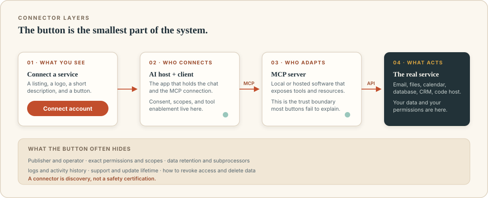

# Connectors: MCP for the rest of us

For a protocol to change how normal people work, it cannot require them to edit JSON in a terminal. It needs a button. That button is usually called a connector.

You click "Connect Google Drive" in your AI assistant. A browser window opens, you sign in, you see a list of permissions, you approve, and you return to the chat. A few seconds later, the assistant can find documents. Behind the button, there may be an MCP server, an OAuth flow, a permissions screen, and a product team deciding what to expose. You did not have to know about JSON-RPC. That is the point of packaging.

But packaging also hides complexity. The button says "Connect your workspace." It does not tell you whether the connector can read every file, whether it retains copies, whether it can send messages as you, or who operates the server. A connector is convenient, not automatically safe.

## What a connector actually is

A connector is a product-level integration presented in an AI application's gallery, settings, or store. It typically bundles:

- an **identity and authorization flow**, such as OAuth;
- one or more **MCP servers** or equivalent tool endpoints;
- a **curated set of tools and resources**;
- user-interface copy and permission prompts;
- configuration, updates, and support.

Sometimes the connector is built by the AI app vendor. Sometimes by the service being connected. Sometimes by an independent developer. The label "connector" does not tell you who is accountable for all those pieces.

If MCP is a common port, a connector is the packaged cable, power adapter, and instruction card. The packaging can be excellent or terrible. It can be certified by a responsible company or hastily shrink-wrapped by an unknown one. The standard tells you the shape of the plug, not the quality of the current.

### Connectors are not always MCP

Many products use "connector" to mean any integration, regardless of the underlying protocol. It might use an internal plugin API, a webhook, a proprietary action system, or plain REST calls. MCP is increasingly common, but the menu label is marketing, not a protocol declaration.

If interoperability matters to you, ask: **Which MCP server, if any, is behind this connector? Can I connect to that server from another compatible app?** If the answer is no or nobody knows, treat it as a product-specific integration and evaluate it on its own terms.

## Local versus hosted connectors

There are two broad deployment patterns.

| Pattern | What happens | Advantages | Questions to ask |
|---|---|---|---|
| Local | The AI app starts a server program on your machine | Access to local files; you control installation; no third party needed for routing | What code am I running? Which folders and credentials can it reach? How is it updated? |
| Hosted or remote | You connect to a server operated by a company or team | Easy setup, OAuth, updates, works across devices | Who operates it? Where is data processed? What is retained? What scopes are requested? |
| Hybrid | A local client talks to an authenticated remote API, or a local helper bridges to a hosted index | Flexibility | More moving parts; unclear boundaries; more places to log data |

A hosted connector is often the easier choice for a nontechnical user. It is also a third-party data relationship. A local connector avoids sending raw files to the connector vendor, but the AI model still receives whatever context the host includes. And the local server itself is code running with your privileges.

Neither pattern is universally safer. The right question is: **which trust boundary does this connector move, and do I accept the new party on the other side?**

## What happens when you click Connect

A typical OAuth-based connector flow looks like this:

1. The AI app shows a connector listing and its requested permissions.
2. You choose an account, ideally a work account dedicated to this purpose.
3. The browser opens the service's authorization page.
4. You authenticate directly with the service, not the AI app.
5. You review the scopes and approve.
6. The service redirects back with an authorization code.
7. The app exchanges the code for tokens and connects to the server.
8. The assistant can now call allowed tools.

The copy on that consent screen matters more than the marketing page. Look for phrases like:

- "Read your email" versus "Send email on your behalf."
- "View files" versus "Edit, delete, and share files."
- "Access your calendar" versus "Manage calendars and settings."
- "Full control of your repository" versus "Read repository contents."
- "Access your organization's data" versus "Access data you can see."

Scopes are not perfectly fine-grained in every service. Sometimes a connector needs a broad scope because the provider only offers broad scopes, and then narrows its actual behavior internally. That can be acceptable, but it should be explained. A connector that asks for administrative access when it only needs to read a folder is overprivileged, whether through laziness or malice.

## Least privilege in practice

The principle is simple: give the connector the smallest set of permissions, on the smallest set of data, for the shortest useful time.

That translates into practical choices:

- **Read before write.** Start with read-only scopes if the workflow only needs drafts or summaries.
- **Choose the narrowest container.** A specific shared drive or project folder is better than the entire account.
- **Use a dedicated account.** A service account or a separate work identity limits what a mistake can reach, though it also requires careful ownership and removal.
- **Limit time.** Prefer tokens with expiration and no unnecessary offline access. Revoke when the project ends.
- **Limit tools in the AI app.** If the app lets you enable specific tools, disable ones you do not use.
- **Approve expensive actions.** Turn on confirmation for sending, deleting, publishing, and financial actions.
- **Separate work and personal.** Do not connect a personal account to an agent that reads from a business workspace unless that is explicitly allowed.

"Read-only" is not risk-free. Reading can leak confidential data into a summary, a log, or a message. But it prevents a large class of destructive outcomes. It is often the right first step while you learn how the agent behaves.

## Connector permissions inside the AI app

A connection has two permission layers:

1. **What the service allows the application or token to access.**
2. **What the AI app exposes to the model in a given conversation.**

A connector might have broad scopes but be configured to offer only three read tools. Conversely, a connector with modest scopes might be enabled in every chat with auto-approval on all actions. The effective permission is the combination.

Look for controls such as:

- enabling or disabling a connector per conversation;
- individually enabling tools;
- requiring approval for writes;
- restricting file or project scope;
- read-only mode;
- audit or activity history;
- the ability to pause or disconnect mid-task.

Product terminology differs. The important thing is to know whether a tool is available to the model and whether it can act without you seeing a confirmation. A connector in a menu is not necessarily active in the current chat.

## The connector gallery is not a safety certification

An official-looking directory may include:

- first-party connectors built by the app vendor;
- connectors built by the service vendor;
- verified partners;
- community submissions;
- experimental or self-hosted links.

"Verified" might mean the publisher owns the domain, the connector passed a functional test, or the vendor reviewed its privacy practices. It rarely means someone audited every tool for security. Listings can also be removed or change hands. Treat the gallery as discovery, not a guarantee.

A sensible evaluation:

1. **Publisher.** Is this the service's official domain and account, or an unknown developer?
2. **Purpose.** Does the connector match the service? A "calendar" connector that also requests contacts and drive access is suspicious.
3. **Permissions.** What can it read, write, and share? Does the requested access match the job?
4. **Data retention.** Does the connector or its operator keep copies? For how long? Can you delete them?
5. **Subprocessors.** Which model providers or cloud services receive the data?
6. **Security contact.** Is there a way to report a problem?
7. **Updates.** Is there a changelog and a version history?
8. **Exit.** Can you export and revoke? Is there a clear removal process?
9. **Fit.** Is this a hosted or local connector? Which trust boundary changes?
10. **Alternatives.** Is there a narrower connector or a built-in feature that can do the same job?

If the only information available is a logo and "Connect," you do not have enough to make an informed decision. That does not mean every unknown connector is malicious. It means you should start it with low privileges, test data, and an ability to undo.

## The shadow connector problem

A new risk appears when connectors are easy to add on personal accounts while doing company work. An employee connects a video transcription service to a meeting, or a note app to a company drive, and suddenly customer data is flowing to a vendor that the company has never reviewed. The employee is trying to be productive. The security team has no inventory.

This is a governance problem, not a model problem. Helpful controls include:

- a clear policy listing approved connectors and prohibited categories;
- an inventory of connected apps and active tokens;
- admin approval for work accounts, or restrictions on third-party OAuth;
- SSO policies that make unapproved connections harder;
- a lightweight exception process so people do not go around the rules;
- periodic access reviews, especially after projects end or employees leave;
- data classification guidance: what may never be pasted, attached, or connected.

For a small business, the policy can be a one-page document and a spreadsheet of connections. The scale changes; the questions do not. You cannot manage a data flow you did not know existed.

## Connector sprawl

Connecting many services feels like giving the assistant more context. Often it gives it more ways to be confused.

Overlapping tools make selection harder: three file systems, two calendars, two task managers. Credentials multiply. The permission story becomes difficult to explain. A prompt injection that reaches one connector may be able to use another to move data.

Start with the minimum for one workflow:

- one source of truth for the task;
- one or two tools per source;
- a clear boundary around what can be changed;
- a review date for whether each connector is still needed.

If a connector is not used in a typical week, disconnect it. If a tool is redundant, disable it. The assistant does not need to feel powerful; it needs to be understandable.

## A worked example: Maya's studio setup

Maya wants help with client work without exposing all of the studio's data. Her first setup might look like this:

| Connector | Access | Tools enabled | Approval | Why |
|---|---|---|---|---|
| Shared project drive | Read-only, `Clients/Atlas` folder | List and read documents | None for reads | Prepare briefs from approved material |
| Calendar | Read and create drafts | List events, create draft event | Approve every create | Avoid double-booking without letting the agent book freely |
| CRM | Read-only | Search client and project records | None for reads | Understand client context |
| Email | Create drafts only | Create draft; no send | Approve every send outside the app | Keep external communication in human hands |
| Chat | Read selected project channel | Search messages | None for reads | Find decisions, but don't post |

She avoids connecting source code, finance, and the entire company drive. She uses her studio account rather than a personal one. She reviews the connector permissions after two weeks. If the setup is useful and calm, she might allow a narrow action such as adding internal attendees to a draft event. If something feels noisy or uncertain, she removes the connector rather than adding more instructions.

The point is not this exact list. It is that every connection has a job, a boundary, and an exit.

## Hosted connector failure modes

When a hosted connector stops working, the cause may be outside your control:

- the OAuth token expired or was revoked;
- the provider changed an API;
- the connector hit a rate limit or usage cap;
- the model host changed its tool interface;
- the remote server is down;
- the permissions changed after an admin update;
- the connector's publisher abandoned it.

The practical response is to check each layer in order: app connection status, account permissions, provider status, server health, and current documentation. Avoid the temptation to "fix" an authorization error by pasting a password or a long-lived token into chat. That converts a temporary connection problem into a permanent security problem.

## Revoking access properly

Disconnecting in the AI app is not always enough. A complete cleanup usually includes:

1. **Remove the connector** from the AI application.
2. **Revoke the token** in the service's connected apps or security settings.
3. **Review active sessions** and remove unrecognized ones.
4. **Delete local server data** if you installed one, including caches and configuration.
5. **Rotate credentials** if you suspect exposure, especially API keys stored on disk.
6. **Review logs** for actions during the period of concern.
7. **Document the change** if this is a team environment.

For a trial, decide the removal date before you connect. A connector you forgot about is still a connector with access.

## Recap

- A connector is product packaging around an integration, often but not always an MCP server.
- Connectors bundle authentication, tools, UI, and support; the label does not tell you who is responsible for each.
- Hosted and local connectors move trust boundaries in different directions. Both need review.
- OAuth grants delegated, scoped access. Read the consent screen and choose the narrowest account and scope.
- Effective permission is the combination of service scope, tools exposed by the AI app, and approval settings.
- The gallery is discovery, not certification. Check publisher, permissions, data handling, and exit.
- Shadow connectors are a governance problem; inventory and policy matter.
- Less is more. Every connection should have a job, a boundary, and a review date.

## Try this

1. List every connector currently attached to your AI accounts. For each, write its job, its access, and the last time you used it.
2. Open one connector's consent screen and read the scopes without clicking approve. Which permissions surprise you?
3. Choose a connector you would like to try. Write a trial plan with test data, a limited account, read-only access, and a removal date.
4. Explain to someone why "available in the connector gallery" is not the same as "approved by our security team."

We have covered what agents are, how tools and MCP work, and how connectors package access. Now we turn to the part that determines whether any of it is a good idea: safety, permissions, and trust.
